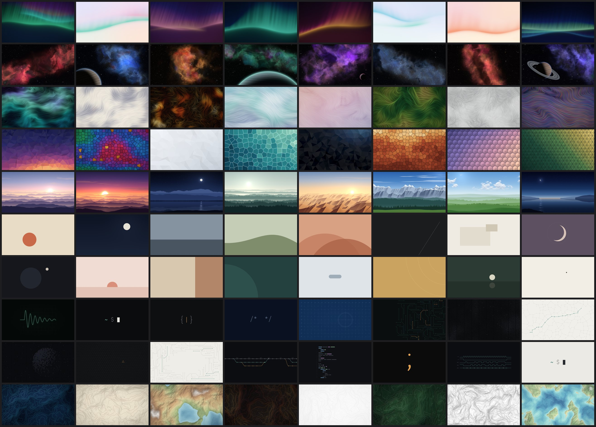

# Public domain wallpapers

Desktop wallpapers you can use for anything. They're dedicated to the public
domain under [CC0 1.0](LICENSE), so you don't need to ask permission or give
credit.

All images are 3840x2160 PNGs.

## Styles

| Style | What it looks like |
|---|---|
| [Aurora](wallpapers/aurora/) | Soft, glowing ribbons of colour over dark or pale skies |
| [Cosmic](wallpapers/cosmic/) | Invented nebulae, star fields and the occasional planet |
| [Flow field](wallpapers/flowfield/) | Thousands of fine lines following a smooth current, like silk or ink |
| [Geometric](wallpapers/geometric/) | Low-poly gradients, stained glass, hexagon and triangle tilings |
| [Landscape](wallpapers/landscape/) | Layered mountains, dunes, hills and coasts fading into haze |
| [Minimal](wallpapers/minimal/) | One to three flat colours and a single shape or line |
| [Tech](wallpapers/tech/) | Terminal prompts, code symbols, circuit traces and grids |
| [Topographic](wallpapers/topographic/) | Contour maps of terrain that doesn't exist |

## Why you can trust the license

A public domain dedication only means something if nobody else has a claim on
the work. To keep it that way:

- The original set was generated procedurally with original code. No outside
  photos, textures, map data or other artwork went into it. Contributions
  have to meet the same bar (see [CONTRIBUTING.md](CONTRIBUTING.md)).
- No fonts were used. The text in the tech wallpapers is made of letterforms
  drawn from scratch for this project, so no typeface license applies.
- No AI image generators are used or accepted.

## Contributing

New wallpapers are welcome. Read [CONTRIBUTING.md](CONTRIBUTING.md) first: you
will be asked to dedicate your work to the public domain too.
